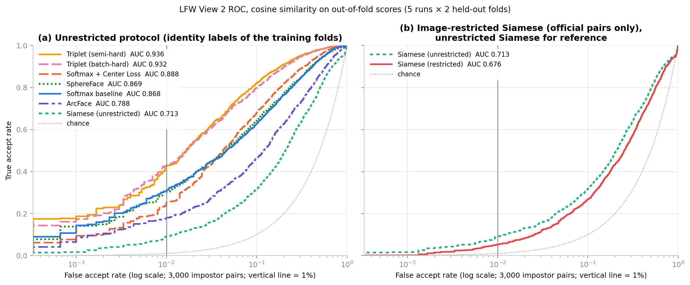

# FaceMetric: deep metric learning for face verification

[](https://github.com/dikshyashrestha/facemetric-ml/actions/workflows/tests.yml)
[](LICENSE)
[](https://dikshyashrestha.github.io/demo.html)

We trained the same ResNet-18 from scratch with five face-embedding losses and compared them head to head on the 6,000 official pairs of Labeled Faces in the Wild (LFW): given two face photos, is it the same person?

**Semi-hard triplet loss reached 86.5% verification accuracy, ahead of Center Loss (80.7%), SphereFace (78.1%) and ArcFace (71.8%), with every method trained from scratch on LFW alone.** It beat every other method on at least 8 of the 10 folds.

**[Try the model in your browser →](https://dikshyashrestha.github.io/demo.html)** The demo runs the semi-hard triplet model (run 4) with ONNX Runtime Web, so uploaded photos never leave the device.



## Key findings

1. **Triplet mining won clearly.** Semi-hard triplet (86.47%) and batch-hard triplet (85.40%) were the top two methods. Semi-hard led the next non-triplet method, Center Loss, by 5.8 percentage points and was more accurate on all 10 folds.
2. **Margin-based softmax losses struggled from scratch.** ArcFace and SphereFace are state of the art with large datasets and pretrained models, but here SphereFace only matched plain softmax (78.08% vs 78.27%) and ArcFace trailed at 71.77%. ArcFace's zero-margin control also scored low, so the gap is not caused by the angular margin alone.
3. **More label information helped.** Siamese training with identity labels (unrestricted) beat pairs-only training (image-restricted) by 3.25 points, and Center Loss improved on softmax by 2.42 points, though softmax kept the higher true-accept rate at a 1% false-accept rate (0.312 vs 0.254).

These come from one seed and a 30-epoch budget; [FINDINGS.md](Comparison_Final/FINDINGS.md) has the full discussion, and [statistical_tests.md](Comparison_Final/statistical_tests.md) the paired tests with Holm correction.

## Team and my role

This was a three-person project for MSDS-3100 Applied Deep Learning at Clark University.

| Member | Contribution |
|---|---|
| **Dikshya Shrestha** ([@dikshyashrestha](https://github.com/dikshyashrestha)) | Siamese network with contrastive loss (image-restricted and unrestricted), its View 1 tuning and View 2 evaluation; the final cross-method comparison, statistical tests and result verification (`Comparison_Final/`) |
| **Aakash Balyan** ([@abalyan2395](https://github.com/abalyan2395)) | Project setup, triplet loss (semi-hard and batch-hard mining) and ArcFace, final README |
| **Apurba Thapaliya** ([@Apurbathapaliya](https://github.com/Apurbathapaliya)) | Softmax baseline, Center Loss and SphereFace |

Shared code in `Common/` (backbone, data loading, evaluation) is used by all five methods.

## About the experiments

All methods use the same randomly initialized ResNet-18 backbone, a 512-dimensional embedding head, and the same preprocessing and evaluation code. The experiments were trained on LFW only, without face-pretrained weights or external training images. Plain softmax is included as a baseline.

## Project layout

| Folder | Contents |
|---|---|
| `Common/` | Shared backbone, datasets, transforms, evaluation, and training utilities |
| `Dataset/` | Preprocessing script and local data, protocols, manifests, and image cache |
| `Model_1_Siamese/` | Contrastive loss under restricted and unrestricted training |
| `Model_2_Triplet/` | Semi-hard and batch-hard online triplet mining |
| `Model_3_Center/` | Plain softmax and softmax with Center Loss |
| `Model_4_Spehereface/` | SphereFace, including margin and annealing experiments |
| `Model_5_ArcFace/` | ArcFace, including scale and margin experiments |
| `Comparison_Final/` | Combined results, ROC curves, statistical tests, and comparison script |

The spelling of `Model_4_Spehereface` is retained in the folder and module names. References to "PDF 4.2" in the code and saved configs point to section 4.2 of the course assignment, which set the reduced five-run evaluation scheme described below.

## Setup

Run the commands below from the project root:

```bash
python3 -m venv .venv
source .venv/bin/activate
python -m pip install -r requirements.txt
```

`requirements.txt` records the direct package versions installed in the local Python 3.12 environment. Historical experiments ran in different environments; each run's `config.json` records its software and hardware. The training code selects MPS, CUDA, or CPU according to availability.

## Preparing LFW

We used the deep-funneled aligned version of LFW from the [Kaggle mirror](https://www.kaggle.com/datasets/jessicali9530/lfw-dataset). Download and extract it under `Dataset/` before running preprocessing. The dataset is not included in the repository or submission.

The extracted files must contain one metadata directory with the original CSV filenames, including `peopleDevTrain.csv`, `peopleDevTest.csv`, `people.csv`, `pairs.csv`, and the development match/mismatch pair CSVs. Within that directory, the script expects one `lfw-deepfunneled/` image directory containing the identity folders. It searches recursively to handle the archive's wrapper directories.

```bash
python Dataset/preprocessdata.py
```

This reconstructs the six official pair/people protocol files and checks their MD5 hashes. It then writes CSV manifests to `Dataset/Manifests/` and resizes the aligned 250×250 images to 112×112 RGB PNGs in `Dataset/Processed/deepfunneled_112/`. No additional face detector or crop is applied. Training uses random horizontal flips and normalization `(pixel - 127.5) / 128`.

To generate only the protocols and manifests:

```bash
python Dataset/preprocessdata.py --metadata-only
```

The metadata CSVs are still needed for this command. Model training and image scoring also need the processed image cache.

## Running the models

Each training file has a `STAGE` setting near the top:

- `"smoke_test"` runs a small check of the training and evaluation pipeline.
- `"view1_tuning"` runs the development experiments.
- `"view2_final"` runs the final evaluation using the selected View 1 settings.

The files are currently set to `"view2_final"`. Set the stage you want, then run the corresponding command from the project root:

| Method | Command |
|---|---|
| Siamese, both protocols | `python -m Model_1_Siamese.siamese` |
| Triplet, both miners | `python -m Model_2_Triplet.triplet_loss` |
| Softmax and Center Loss | `python -m Model_3_Center.center_loss` |
| SphereFace | `python -m Model_4_Spehereface.sphereface` |
| ArcFace | `python -m Model_5_ArcFace.arcface` |

For a new experiment, run View 1 first. Siamese, Center Loss, and SphereFace store the selected settings in `FINAL_CONFIG`; Triplet and ArcFace read their selection from the View 1 tuning summary. Final settings should be chosen from View 1 before running View 2.

Completed runs are reused when their recorded settings match, and interrupted runs can resume from local checkpoints. Running a final-stage command against the supplied completed results therefore does not necessarily retrain the model. Keep existing results separate when starting a new experiment; completed runs should not be mixed with changed settings.

## Evaluation and results

We used the assignment's reduced five-run scheme. Each run trains from scratch on eight View 2 folds and scores two held-out folds: (1, 2), (3, 4), (5, 6), (7, 8), and (9, 10). Training and held-out identities are disjoint. Each fold's decision threshold is selected from the other nine folds' out-of-fold pair scores.

At test time, the embeddings of an image and its horizontal flip are summed and L2-normalized. Pairs are scored with cosine similarity. Siamese and Triplet also report squared Euclidean distance, which agrees with `2 - 2 * cosine` for the normalized embeddings.

| Method | Protocol | Accuracy (%) | AUC | EER | TAR at FAR=1% |
|---|---|---:|---:|---:|---:|
| Triplet, semi-hard | Unrestricted | 86.47 ± 1.62 | 0.9365 | 0.1343 | 0.4280 |
| Triplet, batch-hard | Unrestricted | 85.40 ± 1.90 | 0.9321 | 0.1447 | 0.4283 |
| Softmax + Center Loss | Unrestricted | 80.68 ± 2.50 | 0.8881 | 0.1913 | 0.2537 |
| Softmax baseline | Unrestricted | 78.27 ± 2.35 | 0.8676 | 0.2207 | 0.3117 |
| SphereFace | Unrestricted | 78.08 ± 3.02 | 0.8689 | 0.2150 | 0.3033 |
| ArcFace | Unrestricted | 71.77 ± 1.81 | 0.7883 | 0.2843 | 0.1807 |
| Siamese | Unrestricted | 66.48 ± 3.97 | 0.7134 | 0.3347 | 0.0917 |
| Siamese | Image-restricted | 63.23 ± 2.19 | 0.6761 | 0.3650 | 0.0520 |

Accuracy is the mean ± sample standard deviation across ten folds, using one seed (42). AUC, EER, and TAR are computed from the 6,000 out-of-fold scores. The restricted Siamese row uses pair labels only; the unrestricted methods use training identity labels.

To recompute the main table, fold accuracies, paired tests, training-cost summaries, and combined ROC from the saved results:

```bash
python Comparison_Final/compare_methods.py
```

This writes the comparison outputs to `Comparison_Final/` and runs 204 consistency checks. It does not train models or change their selected settings. It requires the saved model results and the View 2 manifests, which can be regenerated with the metadata-only preprocessing command above. This is the way to reproduce the reported table from the supplied scores; fresh training on different hardware may produce different scores.

## Saved experiment files

View 1 and View 2 results are stored under each model's `results/` folder. The main files are:

- `config.json`: run settings, training-data counts, hardware, and software.
- `training_history.csv` and `training_curves.png`: losses and training diagnostics; View 1 also records validation metrics.
- `run_complete.json`: completed-run summary.
- `heldout_scores.csv`: pairs scored by an individual View 2 run.
- `pair_scores.csv`: all 6,000 final pairs, with columns `fold,img1,img2,label,score`.
- `fold_accuracy.csv`: each fold's threshold and accuracy.
- `summary.json`: aggregate metrics and selected settings.
- `roc.png`, `score_histogram.png`, and `confident_errors.csv`: evaluation plots and error examples.

Siamese and Triplet also save squared-L2 scores and fold results. The aggregate files sit in each variant's View 2 folder; ArcFace uses `results/View_2/` directly.

The comparison uses one seed and a limited training budget. Learning-rate searches were run for Triplet and ArcFace; the other methods used a fixed learning rate. Hardware and batch composition differ across methods, so the recorded training times should not be treated as a hardware-independent cost ranking.

Dataset images, model checkpoints, saved weights, local embedding arrays, and the Python environment are excluded from the submission. Source code, result CSVs, configurations, and the report figures provide the submitted experimental evidence.

## Tests

```bash
python -m pytest -q tests
```

The 36 tests need no dataset or GPU. They cover the embedding network, the normalization formula, flip-averaged test-time embeddings, all five losses (contrastive, triplet mining, Center Loss, SphereFace, ArcFace) and the View 2 evaluation protocol. They also recompute every number in the results table from the saved `pair_scores.csv` files and check that all methods scored the same official pairs. GitHub Actions runs them on every push.

## Ethics and limitations

Face verification is a sensitive technology, and this project is a learning exercise, not a system for identifying people.

- **Biased data.** LFW consists of news photos of public figures and is far from representative: an analysis by Han and Jain (2014) estimated it is about 77% male and 83% white. A model trained only on LFW is likely to be less accurate for women, darker-skinned people, children and older adults. Large evaluations of commercial face recognition (NIST FRVT, Grother et al., 2019) have found demographic differences in error rates even for much stronger systems. We did not measure accuracy by demographic group, because LFW lacks reliable labels for it.
- **Errors have real costs.** At the accuracy-maximizing threshold the best model still gets about 1 in 7 pairs wrong, and at a strict 1% false-accept rate it accepts only about 43% of genuine pairs. A false match can wrongly link someone to a person they are not.
- **Narrow conditions.** The models saw only aligned, mostly front-facing 112×112 crops. Pose, lighting, image quality and occlusion outside that range will degrade results.
- **Consent.** LFW photos were collected from the web without the subjects' consent for this use. LFW's authors also note that the benchmark does not show an algorithm is suitable for any commercial application.
- **Evidence limits.** Results use one seed, and the paired tests are exploratory because folds share trained models.

The demo shows a similarity score and a cautious verdict, processes photos only on the user's device, and states these limits.

## References

- G. B. Huang, M. Ramesh, T. Berg, E. Learned-Miller. *Labeled Faces in the Wild: A Database for Studying Face Recognition in Unconstrained Environments.* UMass Amherst Technical Report 07-49, 2007.
- G. B. Huang, M. Mattar, H. Lee, E. Learned-Miller. *Learning to Align from Scratch.* NeurIPS 2012 (deep-funneled LFW).
- R. Hadsell, S. Chopra, Y. LeCun. *Dimensionality Reduction by Learning an Invariant Mapping.* CVPR 2006 (contrastive loss).
- F. Schroff, D. Kalenichenko, J. Philbin. *FaceNet: A Unified Embedding for Face Recognition and Clustering.* CVPR 2015 (triplet loss, semi-hard mining).
- A. Hermans, L. Beyer, B. Leibe. *In Defense of the Triplet Loss for Person Re-Identification.* arXiv:1703.07737, 2017 (batch-hard mining).
- Y. Wen, K. Zhang, Z. Li, Y. Qiao. *A Discriminative Feature Learning Approach for Deep Face Recognition.* ECCV 2016 (Center Loss).
- W. Liu, Y. Wen, Z. Yu, M. Li, B. Raj, L. Song. *SphereFace: Deep Hypersphere Embedding for Face Recognition.* CVPR 2017.
- J. Deng, J. Guo, N. Xue, S. Zafeiriou. *ArcFace: Additive Angular Margin Loss for Deep Face Recognition.* CVPR 2019.
- K. He, X. Zhang, S. Ren, J. Sun. *Deep Residual Learning for Image Recognition.* CVPR 2016 (ResNet).
- H. Han, A. K. Jain. *Age, Gender and Race Estimation from Unconstrained Face Images.* MSU Technical Report MSU-CSE-14-5, 2014.
- P. Grother, M. Ngan, K. Hanaoka. *Face Recognition Vendor Test (FRVT) Part 3: Demographic Effects.* NIST IR 8280, 2019.

## License

[MIT](LICENSE) © 2026 Dikshya Shrestha, Aakash Balyan, Apurba Thapaliya.
